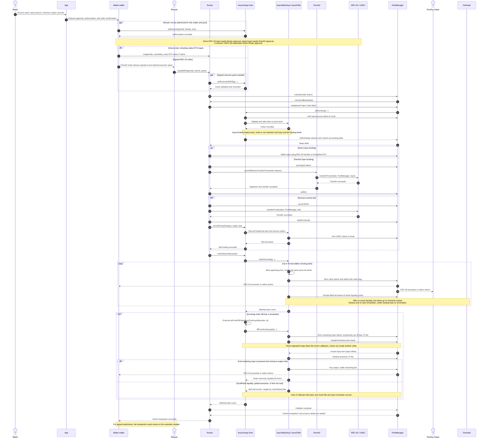
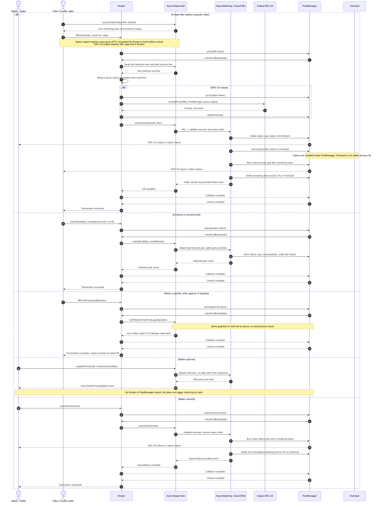
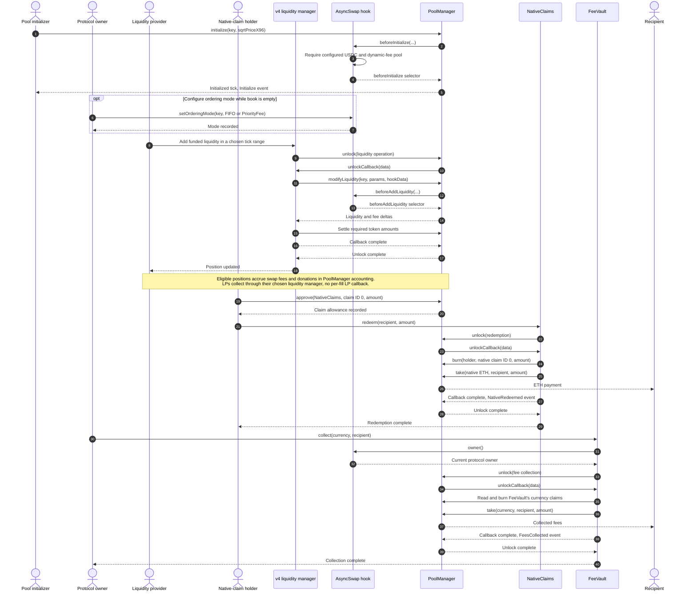

# Contract call sequences

The [protocol overview](protocol.md#3-placing-an-order) contains the short order sequence; this page contains the detailed sequences. See [order lifecycle and priority bids](order-lifecycle.md) for the flowcharts.

Solid arrows are calls or actions; dashed arrows are returns or delivered results. Each sequence groups related transactions; it is not one transaction from top to bottom. The app and wallet represent the user interface, not trusted settlement components. An indexer may observe emitted events for discovery, but neither an API nor an indexer is required by the contracts.

`AsyncMatching` is a linked external library called in the hook's context. `AsyncFiller`, the price tree, and currency-settlement helpers operate on that same context; they are not independent custodians. Arrows from the matching library to PoolManager therefore execute as the hook. ERC-6909 claims and LP fee accounting live inside PoolManager.

### User order, book matching, and LP fallback

The LP fee accrues through PoolManager's position accounting. A priority donation is separate: it rewards liquidity active at the current tick when `donate` runs. LPs do not receive an external callback on every fill.

### Private fillers, continuation, repricing, and cancellation

These are alternative actions on open orders. Private fills and LP retries require the Router to remain authorized by the maker. Book continuation is permissionless and processes at most eight pairs per call.

Signed alternatives are `Hook.updatePriceWithSig` and `Router.cancelWithSig`; a relayer can submit the maker's signature. Signature checks precede the corresponding state change or cancellation unlock. Any uncaught revert rolls back the whole transaction, including transfers and donations.

### Pool setup, liquidity providers, and withdrawals

The liquidity manager below is a compatible Uniswap v4 periphery contract, not Async Swap's order Router. Its precise user-facing methods depend on the chosen periphery; the PoolManager calls shown are the common execution path. Setup and withdrawals are separate transactions from order execution.

Native redemption requires a positive amount and claim allowance; failed ETH delivery reverts the redemption and restores the claims. Fee collection only redeems FeeVault's balances and is restricted to the current hook owner. It cannot redeem maker escrow.

Sources: [Router](../src/Router.sol), [AsyncSwap](../src/AsyncSwap.sol), [AsyncMatching](../src/libraries/AsyncMatching.sol), [AsyncFiller](../src/libraries/AsyncFiller.sol), [NativeClaims](../src/NativeClaims.sol), and [FeeVault](../src/FeeVault.sol).

