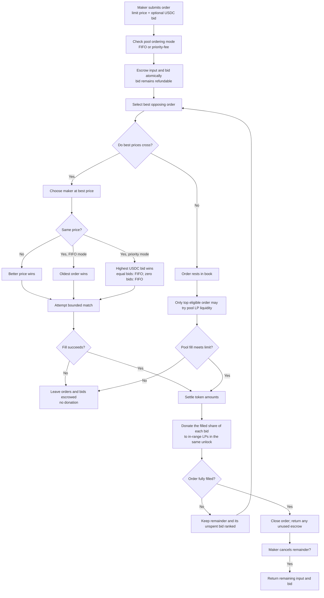
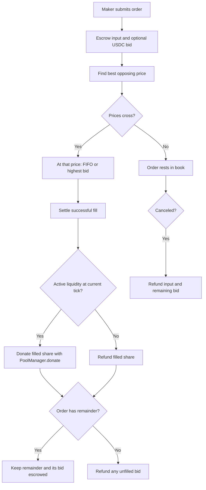

# V2 matching diagrams recovered from chat

Source: **Add EIP-712 signed orders**, following the question “at what point in the lifecycle is the donate made?”
Chat ID: `01a1275e-f4f8-7cb2-ab57-0ae98261ba4b`.
Turn ID: `01a13c4b-5f5b-74b1-ae40-2431ad85c7b1`.
Recovered October 16, 2026.

These diagrams are copied verbatim from the chat. They are historical designs, not the current protocol specification. Updated diagrams matching the current source are in the [order lifecycle documentation](order-lifecycle.md).

The current [V2 README](../README.md) describes non-refundable priority bids: remaining bids are donated when an order is canceled or terminates, and amounts go to FeeVault when no active liquidity exists. Priority-bid mode also requires a minimum bid of 0.10 USDC. The refund and zero-bid paths below therefore do not describe current V2 behavior. The first diagram also contains an original cancellation-arrow placement that should be reviewed before reuse.

## Initial lifecycle blueprint

## Follow-up implementation diagram

