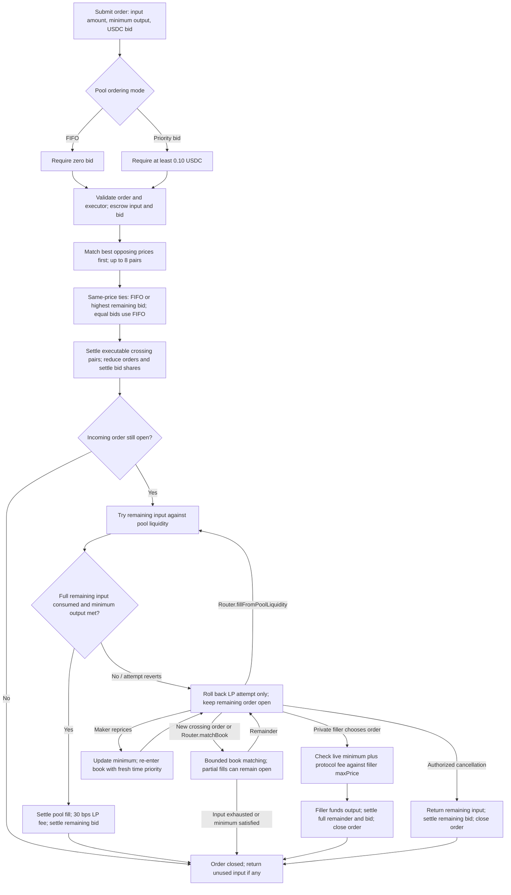
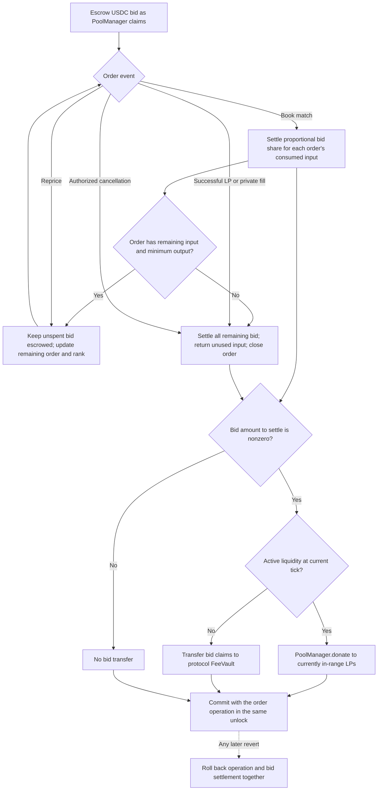

# Order lifecycle and priority bids

Current V2 behavior, checked against the contract source. See also [contract call sequences](contract-call-sequences.md) and the [V2 README](../README.md).

## Order lifecycle

These diagrams describe the current V2 source, not a deployment or mainnet-readiness guarantee. Book matching ranks the best opposing price first; the pool's ordering mode breaks ties at that price. Private fills and explicit LP retries target a specific order and do not enforce the book's global priority queue.

If no executable crossing pair exists, the initial matching pass leaves the order unchanged before the LP attempt. `Router.matchBook` accepts a bound of 1–8 pairs and does not itself retry LP liquidity. An LP retry does not require the order to be first in the book. Private fills require a maker-authorized executor (normally the Router); the filler supplies the live minimum plus the protocol fee in the same transaction. That protocol fee is separate from the LP fee on pool-liquidity fills. Native proceeds and refunds are redeemable claims rather than direct ETH transfers.

Sources: [Router](../src/Router.sol), [AsyncSwap](../src/AsyncSwap.sol), [AsyncMatching](../src/libraries/AsyncMatching.sol), and [AsyncFiller](../src/libraries/AsyncFiller.sol).

## Priority-bid settlement

Priority bids are escrowed in USDC and are **non-refundable**. They rank same-price orders within the book; they do not purchase block inclusion or transaction ordering from the chain.

For each book match, the settled share is `floor(remainingBid * inputUsed / remainingInputBeforeFill)`. If the order terminates, any residual bid is settled too; it is never returned to the maker. A partial fill can leave a bid below the creation minimum. Its remaining bid determines its new same-price rank. If the remaining price key changes, it also receives a fresh sequence number. Maker repricing always assigns fresh time priority without refunding the bid.

Donations go to LPs active at the tick when `donate` executes, which need not be every position traversed during a pool swap. A failed LP self-call rolls back that attempt, including its fee and bid changes, while preserving prior successful book matches in the surrounding transaction. A revert of the surrounding transaction rolls everything back.

Sources: [`_reduceAfterMatch` and `_settleMatchedPriorityFee`](../src/libraries/AsyncMatching.sol), [`settlePriorityFee`, `fill`, and `cancel`](../src/libraries/AsyncFiller.sol). The [original chat diagrams](historical-matching-diagrams.md) are retained as historical references.

