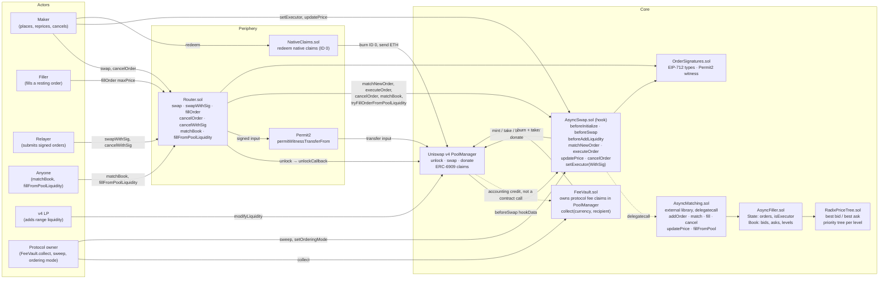
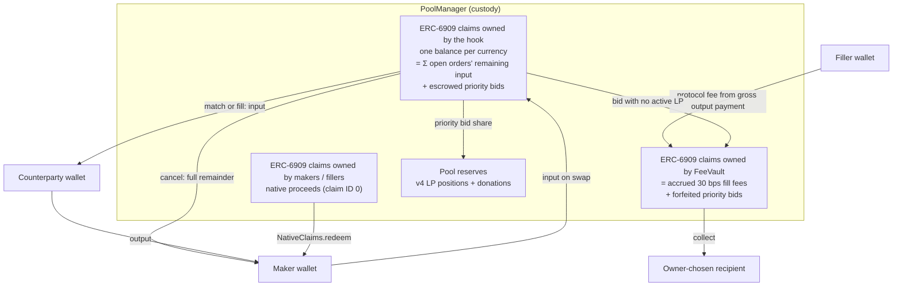
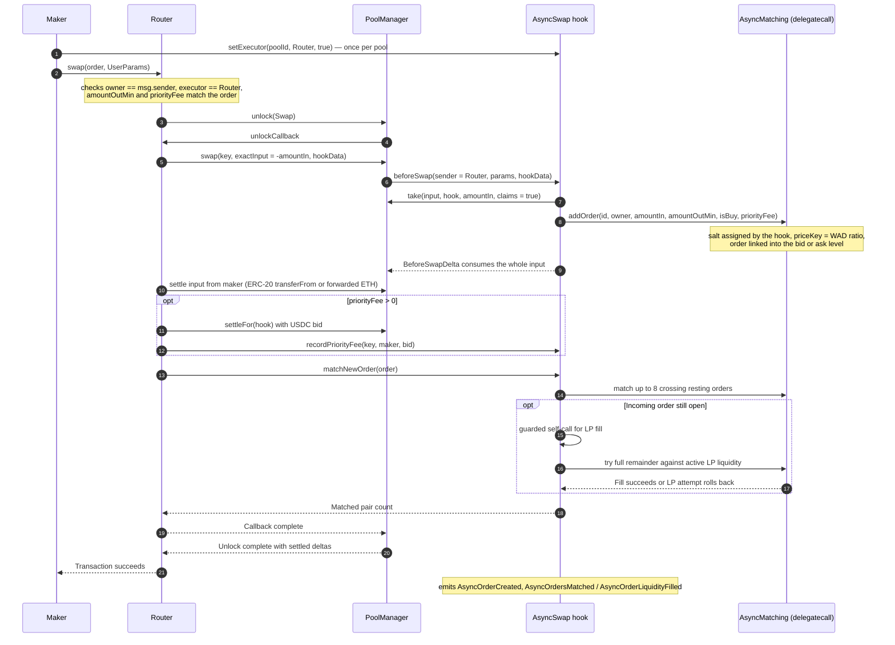
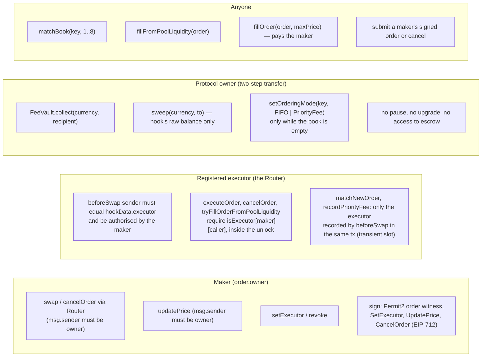
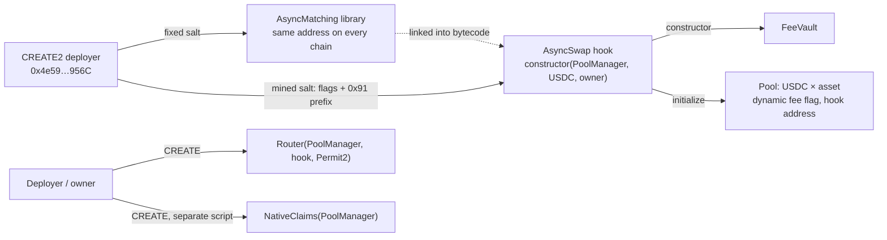

# Async Swap v2 protocol map

Async Swap v2 is a Uniswap v4 hook that turns exact-input swaps into resting limit orders. This page
describes the whole protocol in diagrams: which contracts exist, where funds sit, how an order is
created, matched, filled, repriced and cancelled, and who is allowed to do what. Every box names a
contract, library or function in `src/`, so the diagrams can be checked against the code. The formal
model of the same machine lives in [`asyncswap/v2-proofs`](https://github.com/asyncswap/v2-proofs).

## 1. Components

Every pool that uses the hook must contain the chain's USDC (`numeraire`) and use the dynamic-fee flag
(`beforeInitialize`). `beforeAddLiquidity` is a pass-through: anyone may add ordinary v4 range
positions, and they are the inventory for the LP-fill path. No swap ever reaches the AMM curve
directly, because `beforeSwap` consumes the whole input as an order; the only AMM swaps are the ones
the hook itself performs when it fills a resting order from pool liquidity. The standalone
`MatchingEngine.sol` is a benchmark harness and is not deployed.

FeeVault owns claims recorded in PoolManager. Crediting those claims does not call FeeVault.

## 2. Where funds live

Fees, by path: an order-to-order match charges nothing; a filler fill (`Router.fillOrder`) pays
the maker's live minimum plus 30 bps of gross output, and that fee lands in the FeeVault as claims;
an LP fill charges the 30 bps dynamic LP fee to the active v4 positions. `calculateHookFee` is zero.
Priority bids are escrowed as hook claims when the order is created (`recordPriorityFee`), donated
proportionally to active LPs as input fills, and forfeited to the FeeVault only when the pool has no
active liquidity at that moment. A bid counts only once it is escrowed: an order whose bid was never
paid (placed straight through the PoolManager, not the Router) queues as if its bid were 0, and
fills, matches and cancels settle only the paid bid, so an unpaid bid can never block the book
(`test/UnpaidBidInvariant.t.sol`).

Invariant proved in `v2-proofs` and fuzzed by `MatchingInvariantTest` and `UnpaidBidInvariantTest`: the hook's claim balance for
each currency equals the sum of remaining inputs of open orders plus escrowed bids, and nothing is
created or destroyed by a match. The hook's own token balance is zero between transactions, so
`sweep` can only move stranded ETH or donations, never escrow.

## 3. Placing an order

Signed orders follow the same path through `swapWithSig`. The maker signs one Permit2
`PermitWitnessTransferFrom` whose witness is `OrderSignatures.hashOrder(order)`, so the signature
both moves the input and commits to the order. A relayer can also attach a signed `SetExecutor` grant
for the maker's first order on a pool.

## 4. Everything after placement

Filler fills, book continuation, LP retries, repricing, cancellation, pool setup, native-claim
redemption and fee collection are drawn step by step in
[`contract-call-sequences.md`](contract-call-sequences.md); the lifecycle and priority-bid flowcharts
are in [`order-lifecycle.md`](order-lifecycle.md). Three facts to keep in mind while reading them:

- An order-to-order match charges no fee. The 30 bps protocol fee is paid by the filler on top of the
  maker's live minimum and is credited to the FeeVault as ERC-6909 claims inside the PoolManager; the
  LP-fill path instead charges the 30 bps dynamic LP fee to active v4 positions. `calculateHookFee`
  is zero.
- `updatePrice` only re-ranks the order in the book. It needs no PoolManager unlock and triggers no
  matching; a later crossing order, `matchBook`, a filler or an LP retry has to execute it.
- `matchNewOrder` and `recordPriorityFee` are gated by a transient slot that `beforeSwap` writes for
  the current transaction. `executeOrder`, `cancelOrder` and `tryFillOrderFromPoolLiquidity` check
  `isExecutor[maker][caller]` instead.

An order's identity is `keccak(chainId, poolId, owner, zeroForOne, salt)`. The hook assigns the
salt at creation and emits it in `AsyncOrderCreated`; later calls recompute the id from the maker's
struct, so a maker needs the event or an indexer to cancel or reprice.

## 5. Authorization

Signed maker actions use unordered nonces: `AsyncSwap.nonceUsed` for `SetExecutor` and
`UpdatePrice`, `Router.cancelNonceUsed` for `CancelOrder`, and Permit2's own nonces for order
witnesses. The Permit2 witness binds maker, both tokens, amounts, bid and pool; it leaves out
`sqrtPrice` (never read, the hook consumes the whole swap) and `salt` (assigned by the hook).

## 6. Deployment shape

`script/deploy.sh <chain-key> [dry-run|broadcast|verify]` runs this sequence against
`script/config/chains.json`. On chains whose gas token has an ERC-20 twin (Arc: native USDC and
`0x3600…0000` are one balance) never initialize a native-currency pool; pair the ERC-20 USDC with a
normal ERC-20 asset.

See also [`price-key-crossing.md`](price-key-crossing.md) for how truncated price keys decide
whether two orders cross, and [mainnet readiness](../MAINNET_READINESS.md) for the release gate.
